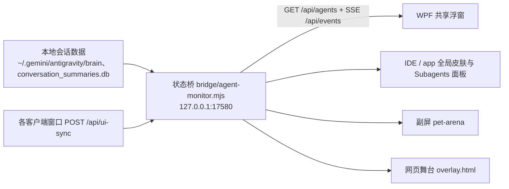

# 🐾 Antigravity Pokémon Pets

> An unofficial, Windows-only fan project that adds glassmorphism skins, a multi-session "agent pets" overlay and a live agent-status bridge to Google Antigravity IDE / Antigravity 2.0.

为 **Antigravity IDE** 与 **Antigravity 2.0（`Antigravity.exe`）** 打造的**智能体桌宠套件**：每个正在运行的 AI 智能体（会话领队与子智能体）都会有一只伙伴陪着，按「项目 → 会话」排成队列，实时显示思考中 / 工作中 / 休眠等状态、上下文占用与缓存命中率；同时附带 6 套玻璃拟态配色皮肤与代码配色主题。

> [!WARNING]
> 这是**非官方第三方工具**，与 Google、Nintendo、The Pokémon Company 均无关联。全局皮肤功能会**修改本机 Antigravity 安装文件**，请先阅读下方 [⚠️ 风险提示](#️-风险提示)。

<!-- 截图占位：请把截图放到 docs/images/，并替换下面的文件名 -->
| 桌面共享浮窗 | IDE 全局皮肤 + Subagents 面板 | 副屏「桌宠乐园」 |
|---|---|---|
| `docs/images/overlay.png`（待补） | `docs/images/global-skin.png`（待补） | `docs/images/pet-arena.png`（待补） |

---

## ✨ 功能介绍

### 🐾 每个 AI 智能体都有一只伙伴
你在 Antigravity 里对话的主智能体（👑 领队）和它派出去干活的子智能体，各自都会配一只伙伴。伙伴的动作会实时反映智能体在做什么：

| 💭 思考中 | ⚡ 工作中 | 💤 休眠 | 🎉 庆祝 | 😵 出错 |
| :---: | :---: | :---: | :---: | :---: |
| 歪头冒思考气泡 | 跳动、放招式特效 | 蜷缩打瞌睡 | 欢呼撒星星 | 眩晕圈圈眼 |

### 🚩 多项目、多会话自动排队
同时开着好几个项目、好几个对话也不会乱：

- **一个会话一排**，同一项目的会话归在同一个 `📁 项目名` 下；
- **领队永远站在最左边**，后面跟着它的子智能体；
- 闲置超过 60 秒的子智能体会自动退场；只要还有子智能体在干活，领队就一直守在排头；
- **单击领队**看会话标题和所属项目，**双击领队**直接跳到对应的 Antigravity 窗口和对话。

### 🪟 桌面悬浮窗
一个透明、置顶的桌面小窗，显示所有项目的伙伴队列：

- 不管开几个 Antigravity 窗口，**全局只有一个浮窗**；
- **双环进度条**：外圈红色是已用上下文比例，内圈绿色是缓存命中率，哪个智能体快塞满、哪个缓存掉了一眼就知道；
- 3D 高清动图 / 像素风两种画风随时切换，支持换肤、点击穿透、收起；
- 可设置**与 Antigravity 同启同停**，打开 IDE 时浮窗自动出现。

### 🎨 Antigravity 全界面皮肤
不只是编辑器配色，而是把**整个 Antigravity 窗口**（标题栏、对话气泡、代码块、输入框、侧边面板）换成玻璃拟态风格：

- 7 套配色：`mewtwo`（默认）、`pikachu`、`gengar`、`charizard`、`umbreon`、`pokedex-light`、`rotom-light`；
- 任意窗口切换后，所有窗口、浮窗、副屏一起变；
- 右侧 `Subagents` 面板升级成「编队卡片」：伙伴动图、能量条、`⚡ WORKING` / `💭 THINKING` / `💤 SLEEP` 状态徽章，原有点击交互全部保留；
- 同时支持 Antigravity IDE 和 Antigravity 2.0，修改前自动备份，一条命令就能完整还原。

### 🧩 更多入口
- **IDE 主题扩展**：6 套代码配色主题，侧边栏里也能看到会话队列，IDE 启动时自动拉起浮窗。
- **Antigravity 2.0 副屏插件「桌宠乐园」**：在右侧副屏看伙伴队列，每 10 秒自动巡检后台服务，挂了会自己拉起来。
- **网页舞台**：浏览器版大舞台，适合放在副屏上全屏看。

### 🎁 可替换的皮肤包
伙伴长什么样由「皮肤包」决定，可以自己做：

- 仓库自带原创默认包「像素小伙伴」（CC0，随便用）；
- 附带 7 只宝可梦精灵素材（仅限个人非商业使用，见 [NOTICE.md](NOTICE.md)），也可以用脚本联网下载全世代精灵；
- 每只伙伴的名字、动图、稀有度、闪光外观都写在一个 `pack.json` 里。

### 🔒 轻量、只在本机运行
- 后台只有一个本地小服务（`127.0.0.1:17580`），**只读**本机的会话记录，不上传任何数据；
- 只用 Node.js 自带功能，**不需要 `npm install`**；后台静默运行，不弹命令行窗口。

> 每项功能的详细说明、操作方式与实现原理见 **[docs/FEATURES.md](docs/FEATURES.md)**。

## 🖥️ 支持的环境

| 项目 | 要求 |
|---|---|
| 操作系统 | Windows 10 / 11（浮窗依赖 WPF 与 Win32） |
| Node.js | **v24+**（使用 `node:sqlite`、原生 `fetch` 等内置 API） |
| PowerShell | Windows PowerShell 5.1（系统自带） |
| 客户端 | Antigravity IDE 和/或 Antigravity 2.0（默认安装在 `%LOCALAPPDATA%\Programs\` 下） |
| 可选 | Microsoft Edge / WebView2（打开网页舞台 `overlay.html`） |

## 🚀 快速开始

```powershell
git clone https://github.com/Qin-long/antigravity-pets.git
cd antigravity-pets

# 全量安装：状态桥 + IDE 主题扩展 + 全局皮肤 + 副屏插件 + 桌面浮窗
powershell.exe -NoProfile -ExecutionPolicy Bypass -File .\start-pokemon-ide.ps1 -InstallAll -Theme mewtwo
```

- **Antigravity IDE**：执行后按 `Ctrl+R`（`Developer: Reload Window`）生效。
- **Antigravity 2.0**：注入全局皮肤前请**先完全退出 app**（运行中 `app.asar` 被占用会提示失败），注入后再打开。
- **副屏插件**：同步完成后，在 Antigravity 的 **Customizations** 界面手动开启 `pokemon-agent-pets`（脚本不会修改 `~/.gemini/config/config.json`）。

### 常用命令

```powershell
# 只启动状态桥 + 桌面浮窗（不改动任何客户端文件）
powershell.exe -NoProfile -ExecutionPolicy Bypass -File .\start-pokemon-ide.ps1

# 单独注入 / 切换全局皮肤（-Theme: mewtwo | pikachu | gengar | charizard | umbreon | pokedex-light | rotom-light）
powershell.exe -NoProfile -ExecutionPolicy Bypass -File .\start-pokemon-ide.ps1 -ApplyGlobalSkin -Theme gengar

# app 正在运行时，后台等待其退出后自动写入皮肤
powershell.exe -NoProfile -ExecutionPolicy Bypass -File .\vscode-pokemon-theme\full-app-skin\apply-global-skin.ps1 -Theme gengar -WaitForAppExit

# 单独安装 IDE 主题扩展 / 同步副屏插件
powershell.exe -NoProfile -ExecutionPolicy Bypass -File .\start-pokemon-ide.ps1 -InstallTheme -NoDesktopPet
powershell.exe -NoProfile -ExecutionPolicy Bypass -File .\plugin-bundle\sync-plugin.ps1

# 像素画风 + 与 IDE 同启同停
powershell.exe -NoProfile -ExecutionPolicy Bypass -File .\start-pokemon-ide.ps1 -SpriteStyle pixel -BindToIde

# 打开 HTML5 网页舞台 / 浮窗点击穿透
powershell.exe -NoProfile -ExecutionPolicy Bypass -File .\start-pokemon-ide.ps1 -OpenWebStage -ClickThrough

# 只做检查并输出 JSON 状态
powershell.exe -NoProfile -ExecutionPolicy Bypass -File .\start-pokemon-ide.ps1 -CheckOnly

# 双击即可：同时启动 Antigravity 与绑定生命周期的桌面浮窗
.\start-antigravity-with-pets.cmd
```

`start-pokemon-ide.ps1` 的全部参数：`-Theme`、`-SpriteStyle`（`showdown` / `pixel`）、`-BridgeUrl`、`-BindToIde`、`-LaunchIde`、`-InstallTheme`、`-InstallPlugin`、`-ApplyGlobalSkin`、`-RestoreGlobalSkin`、`-InstallAll`、`-OpenWebStage`、`-ClickThrough`、`-NoDesktopPet`、`-StopAll`、`-CheckOnly`。

## 📁 目录结构

```text
antigravity-pets/
├── start-pokemon-ide.ps1              # 一键启动 / 安装 / 还原 / 停止入口
├── start-antigravity-with-pets.cmd    # 同启 Antigravity + 桌面浮窗
├── restart-and-patch-antigravity.cmd  # 辅助脚本：结束 app 后替换已暂存的 app.asar 并重启
├── bridge/                            # 零依赖本地状态桥（127.0.0.1:17580）
│   ├── agent-monitor.mjs              #   REST + SSE 主服务，聚合会话 / 子智能体 / 列队
│   ├── hook-handler.mjs               #   可选的非阻塞生命周期钩子
│   ├── pet-packs.mjs / describe-pack.mjs / pokemon-gacha.mjs   # 皮肤包与图鉴抽卡
│   └── context-window.mjs / cache-ledger.mjs / ide-session.mjs / http-guard.mjs
├── desktop-pet/
│   ├── pokemon-desktop-overlay.ps1    #   WPF 全局共享置顶浮窗（含 -SelfTest 自检）
│   ├── launch-desktop-pet.ps1         #   防多开启动器（-StopPets 收回）
│   ├── silent-launch.vbs              #   无窗口静默启动宿主
│   └── overlay.html                   #   HTML5 网页舞台
├── vscode-pokemon-theme/              # IDE 扩展：6 套配色主题 + 自启动浮窗 + 侧边栏
│   └── full-app-skin/                 #   全局皮肤注入 / 还原（apply- / restore-global-skin.ps1, patch-engine.mjs）
├── theme-css/                         # 玻璃拟态 UI 皮肤样式
├── plugin-bundle/
│   ├── sync-plugin.ps1                #   同步插件到 ~/.gemini/config/plugins/（支持 -DryRun）
│   └── pokemon-agent-pets/            #   Antigravity 2.0 副屏插件（sidecars/pet-arena、hooks、skills、vendor）
├── packs/critters/                    # 默认皮肤包「像素小伙伴」（原创，CC0）
├── tools/                             # 零依赖皮肤包生成 / 导出脚本
├── assets/                            # 共享前端脚本 + 宝可梦精灵素材（非 MIT，见 NOTICE.md）
├── docs/architecture.md               # 架构与状态桥接口契约
└── docs/FEATURES.md                   # 功能详解
```

## ⚙️ 工作原理



1. **状态桥**只监听本机 `127.0.0.1:17580`，以只读方式读取 Antigravity 在本地写入的会话摘要库、轨迹日志与 Swarm 成员信息，汇总成 `projects[].queues` 结构。主要接口：`/health`、`/api/agents`、`/api/events`（SSE）、`/api/ui-sync`、`/api/theme`、`/api/focus-session`、`/api/summon-overlay`、`/api/packs`、`/api/pack`。
2. **四个端面**都从状态桥取数据：WPF 桌面浮窗、注入到客户端的全局皮肤脚本（含 `Subagents` 面板增强）、Antigravity 2.0 副屏插件、HTML5 网页舞台。
3. **全局皮肤**：Antigravity IDE 在 `workbench.html` / `workbench-jetski-agent.html` 中以外链方式引入皮肤 CSS/JS，并重算 `product.json` 校验和；Antigravity 2.0 在 `app.asar` 内挂钩子，皮肤文件放在 `resources\pokemon-skin\`。所有被改动文件都会先存为 `*.pokemon-backup`。

更多细节见 [docs/architecture.md](docs/architecture.md)。

## 🎨 皮肤包

皮肤包按以下顺序查找（同 id 时后者覆盖前者）：

| 位置 | 用途 |
|---|---|
| `packs/<id>/` | 仓库自带的包 |
| `~/.gemini/antigravity/pet-packs/<id>/` | 本机私有包 |
| 环境变量 `POKEMON_PACK_DIRS` | 额外目录（多个用 `;` 分隔） |

- **默认包「像素小伙伴」**（`packs/critters/`，CC0）：7 只完全由代码绘制的原创像素伙伴，可用 `node tools/build-critters-pack.mjs` 重新生成。
- **宝可梦包（仅限个人非商业使用）**：仓库在 `assets/official-sprites/` 中附带 7 只宝可梦的精灵素材。执行 `node tools/export-pokemon-pack.mjs` 会把它复制成本机私有包 `~/.gemini/antigravity/pet-packs/pokemon/`（支持 `--from <dir>`、`--to <dir>`、`--dry-run`）；`node tools/build-allgen-pokemon-pack.mjs` 会联网下载全世代精灵生成私有包。存在 `pokemon` 包时优先使用，否则使用 `critters`。
- `pack.json` 格式可参考 [packs/critters/pack.json](packs/critters/pack.json)；舞台「设置 → 皮肤包」或副屏工具栏可随时切换。

## 🧹 卸载与还原

```powershell
# 1. 还原 Antigravity 客户端原始文件（从 *.pokemon-backup 恢复，含 product.json 校验和）
powershell.exe -NoProfile -ExecutionPolicy Bypass -File .\start-pokemon-ide.ps1 -RestoreGlobalSkin

# 2. 收回桌面浮窗并停止后台状态桥
powershell.exe -NoProfile -ExecutionPolicy Bypass -File .\start-pokemon-ide.ps1 -StopAll
```

3. 在 Antigravity 的 Customizations 中关闭 / 移除 `pokemon-agent-pets`，再删除 `~/.gemini/config/plugins/pokemon-agent-pets/`。
4. 在 IDE 扩展列表中卸载 `vscode-pokemon-theme`。
5. 如需清理图鉴与私有包，删除 `~/.gemini/antigravity/pet-packs/`。

还原 Antigravity 2.0 前同样需要先退出 app。

## ⚠️ 风险提示

- **会修改本机 Antigravity 安装文件**：`-ApplyGlobalSkin` / `-InstallAll` 会改写客户端的 `workbench*.html`、`product.json` 校验和、Antigravity 2.0 的 `app.asar` 等文件。这不是官方支持的用法，可能导致客户端异常或出现完整性警告。
- **客户端升级后需要重新应用**：自动更新会覆盖被修改的文件，皮肤随之失效；如更新后异常，先执行 `-RestoreGlobalSkin`，再重新 `-ApplyGlobalSkin`。
- 请勿在多人共用或受管控的机器上使用；使用前建议确认 `*.pokemon-backup` 备份已生成。
- 状态桥只监听 `127.0.0.1`，但会读取本机的会话标题与轨迹日志用于展示，不会上传到任何地方。
- **使用风险由使用者自行承担**，详见 [NOTICE.md](NOTICE.md)。

## ❓ 常见问题

**Q：执行后界面没有变化？**
IDE 按 `Ctrl+R` 重载窗口；Antigravity 2.0 需要在注入前完全退出、注入后重新打开。

**Q：提示 `app.asar` 被占用？**
Antigravity 2.0 正在运行。退出后重试，或使用 `apply-global-skin.ps1 -WaitForAppExit` 在后台等待。

**Q：浮窗不见了？**
点过浮窗的 `[×]` 后不会自动重弹。重新执行 `start-pokemon-ide.ps1`，或在副屏 / 皮肤菜单中点「召唤浮窗」（`POST /api/summon-overlay`）。

**Q：如何确认状态桥正常？**
`Invoke-RestMethod http://127.0.0.1:17580/health`，以及 `Invoke-RestMethod http://127.0.0.1:17580/api/agents` 查看当前列队。

**Q：PowerShell 提示禁止运行脚本？**
按文中示例使用 `powershell.exe -ExecutionPolicy Bypass -File ...` 调用即可，无需修改系统执行策略。

**Q：支持 macOS / Linux 吗？**
暂不支持。桌面浮窗与静默启动依赖 Windows 专有组件。

## 🤝 贡献

欢迎 Issue 与 PR！开发约定（零第三方依赖、注入脚本禁用 `innerHTML`、PowerShell 写 JSON 用无 BOM UTF-8）和提交前自检命令见 [CONTRIBUTING.md](CONTRIBUTING.md)，版本变化见 [CHANGELOG.md](CHANGELOG.md)。

## 📄 许可证与版权声明

- 本仓库的**原创代码与文档**以 [MIT License](LICENSE) 授权。
- **宝可梦相关素材不适用 MIT**：Pokémon 及其角色名称、形象、精灵图的版权归 Nintendo / Creatures Inc. / GAME FREAK inc. / The Pokémon Company 所有。本项目为非官方粉丝作品，与上述公司无关；`assets/` 下的宝可梦素材**仅供个人学习与非商业用途**，权利人要求时将立即移除。
- 默认皮肤包 `packs/critters/` 为原创作品，以 CC0 1.0 发布。
- 「Antigravity」是 Google 的产品名称，本项目未获 Google 官方认可。

素材来源、第三方许可与完整免责说明见 [NOTICE.md](NOTICE.md)。
