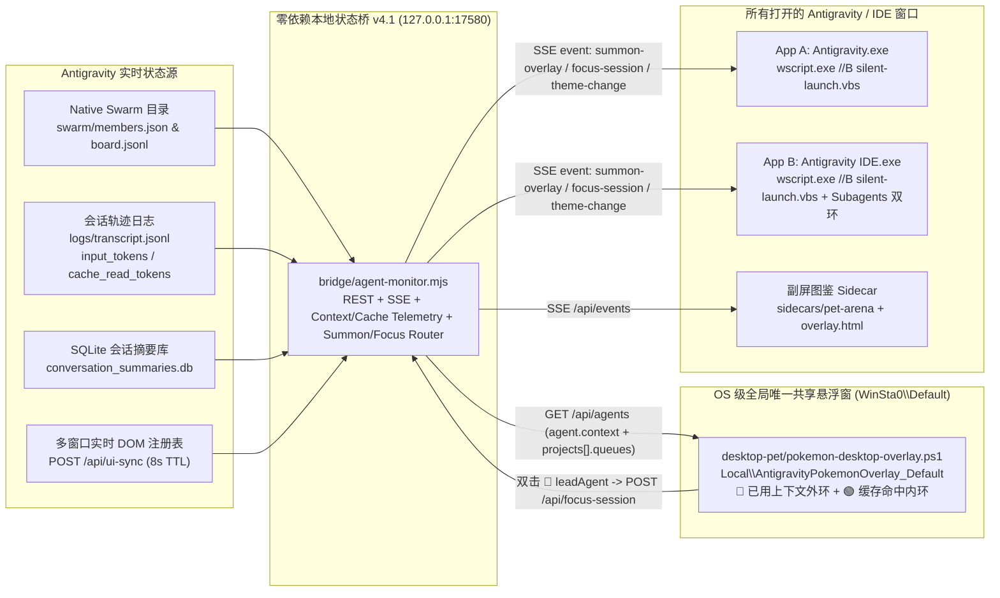

# Antigravity 宝可梦主题皮肤与智能体悬浮桌宠 (v4.1) — 系统架构与实时桥接协议

本文档记录本地 Windows 环境下 **Antigravity IDE** 与 **Antigravity 2.0** 的目录规范、无弹窗静默进程拉起契约，以及 **v4.1 每智能体上下文/缓存命中双环进度条 + 显式召唤浮窗 + v4.0 全局唯一共享悬浮窗 + 双击领队自动弹起对应项目与会话**（`bridge/agent-monitor.mjs` 与 `bridge/hook-handler.mjs`）的完整契约。

---

## 1. v4.1 整体架构概览（静默守护 + 上下文/缓存双环 + 全局唯一共享浮窗）



### 1.1 v4.1 三大核心升级要点
1. **彻底根除 Windows 11 `cmd.exe` / `WindowsTerminal.exe` 弹窗（零控制台静默拉起铁律）**：
   - **根因揭示**：本机 `PATH` 中的 `%USERPROFILE%\.nvmd\bin\node.exe` 为 `nvmd` 垫片，内部会派生 `"cmd.exe" /C node ...`；当配合 `child_process.spawn(..., { detached: true })` 调用控制台子系统程序时，Windows 11 默认终端（`WindowsTerminal.exe -Embedding`）会拦截 `AllocConsole` 弹出可见 `C:\Windows\system32\cmd.exe` 标签页。
   - **修复契约**：全栈严禁使用 `cmd.exe`、`shell: true` 或对控制台 `.exe` 使用 `detached: true`；统一解析真实 Node 二进制路径（`~/.nvmd/versions/<default>/node.exe`）并通过 Win32 GUI 子系统宿主 `C:\Windows\System32\wscript.exe //B //Nologo desktop-pet\silent-launch.vbs`（`WScript.Shell.Run ..., 0, False`）无窗拉起后台进程；WPF 浮窗在 `$MainWindow.Show()` 后显式执行二次 Win32 `ShowWindow(hwnd, SW_SHOW)` 突破父进程 `STARTUPINFO.wShowWindow = SW_HIDE` 对首次 `Show()` 的抑制。
2. **每智能体实时上下文与缓存命中环形进度条 (`agent.context`)**：
   - `bridge/agent-monitor.mjs` 直接从每个智能体（含 `👑 leadAgent` 与全部 `subagents`）的 `transcript.jsonl` 最新 `PLANNER_RESPONSE` 步骤提取硬件级精确 `input_tokens`、`cache_read_tokens` 与 `output_tokens`（叠加回合中途新增步骤字符估算）：
     - **🔴 红色外环 (`context.usedPct` = `usedTokens / maxTokens`)**：展示当前智能体**已用上下文占比**（如 Gemini 1M 窗口、Claude 200k 窗口）。
     - **🟢 绿色内环 (`context.cacheHitPct` = `cachedTokens / promptTokens`)**：展示最新推理轮次的 **Prompt KV 缓存命中率**（直观反映 `300s` TTL 热缓存命中 vs 冷启动重算）。
3. **显式一键召唤浮窗 (`POST /api/summon-overlay`) 与拒绝 10 秒死循环重拉**：
   - 各端守护仅在启动时静默尝试拉起一次浮窗（若用户点击浮窗 `[×]` 静音则绝不强行重弹）；顶部 `🎨 换肤胶囊` 下拉菜单、状态栏与副屏均提供 **`🪟 召唤/重开全局置顶浮窗`** 按钮，调用 `POST /api/summon-overlay` 自动清除静音标记并广播 SSE `event: summon-overlay`，由桌面宿主即时静默唤醒浮窗。

---

## 2. 本地 Windows 运行环境与目录规范

### 2.1 系统运行时
| 组件 | 本地版本 / 路径 | 用途说明 |
| :--- | :--- | :--- |
| **Node.js** | `v24.14.0`（支持原生 ESM、`node:sqlite`、`fetch`、`AbortSignal.timeout`） | 运行零依赖 `agent-monitor.mjs`、`hook-handler.mjs` 与 Sidecar |
| **Windows PowerShell + .NET WPF + Win32 P/Invoke** | `powershell.exe -STA` (`PresentationFramework` + `user32.dll`) | 零安装实现全局唯一置顶透明浮窗与双击 `SetForegroundWindow` 窗口唤醒 |
| **Edge & WebView2 Runtime** | `C:\Program Files (x86)\Microsoft\Edge\Application\msedge.exe` | 支持高帧率 HTML/SVG 动画渲染与应用模式窗口 |

### 2.2 Antigravity 2.0 (App A) 与 Antigravity IDE (App B) 关键路径
| 平台面 | 路径 | 说明 |
| :--- | :--- | :--- |
| **App A 主程序 (`Antigravity.exe`)** | `%LOCALAPPDATA%\Programs\antigravity\Antigravity.exe` | 解包注入点：`resources\app\dist\utils.js`（Electron 主进程 `WinSta0\Default`） |
| **App B 主程序 (`Antigravity IDE.exe`)** | `%LOCALAPPDATA%\Programs\Antigravity IDE\Antigravity IDE.exe` | Electron 主进程入口：`resources\app\out\main.js`（`"type": "module"` ESM，不在 `product.json` `checksums` 中）；渲染入口：`workbench.html` 与 `workbench-jetski-agent.html` |
| **IDE 扩展安装目录** | `%USERPROFILE%\.antigravity-ide\extensions\` 与 `~/.antigravity/extensions/` | 注意：`workbench-jetski-agent.html` 通过 `jetskiAgent.js` 直接引导，**不启动** VS Code `extensionHostProcess.js`，因此 `out/main.js` 主进程钩子对 Jetski 窗口自动拉起浮窗至关重要！ |
| **智能体 Brain 轨迹与摘要库** | `%USERPROFILE%\.gemini\antigravity\brain\<conv-id>\`<br/>`%USERPROFILE%\.gemini\antigravity\conversation_summaries.db` | 存放所有会话、子智能体、Swarm 实时轨迹与 SQLite 会话标题/工作区索引 |
| **全局插件目录** | `%USERPROFILE%\.gemini\config\plugins\pokemon-agent-pets\` | Antigravity 2.0 副屏插件目录（严禁脚本触碰 `~/.gemini/config/config.json`） |

---

## 3. v4.1 状态桥 HTTP / SSE 接口契约 (`127.0.0.1:17580`)

所有接口均返回跨域头 `Access-Control-Allow-Origin: *`，支持 `GET, POST, DELETE, OPTIONS`。

### 3.1 `GET /health`
返回服务健康状态、`version: "4.1.0"`、`mode: "single-shared-overlay"`、当前全局主题 `activeTheme`、`summonRequestedAt` / `lastSummonRequest` 及已连接窗口数 `connectedWindowCount`。

### 3.2 `GET /api/agents`（及别名 `GET /api/queues`）
除完整保留 v3.0 / v4.0 的 `projects[].queues[]`、`leadAgent` 排头、`subagentIdleTtlMs: 60000` 自动退场、领队保活与窗口聚焦路由字段外，新增 v4.1 字段：
- `version`: `"4.1.0"`，`mode`: `"single-shared-overlay"`
- `summonRequestedAt`: 最近 `30s` 内的召唤浮窗请求 ISO 时间戳（无活动召唤时为 `null`）
- `lastSummonRequest`: 召唤详情载荷 `{ requestId, summonSeq, requestedAt, source, theme, spriteStyle, forceRestart }`
- **每个 `leadAgent`、`subagent`、`queue.members[]` 与 `agents[]` 均包含 `context` 对象**：
  ```json
  "context": {
    "usedTokens": 197149,
    "maxTokens": 1000000,
    "usedPct": 19.7,
    "cachedTokens": 189024,
    "uncachedTokens": 6021,
    "promptTokens": 195045,
    "outputTokens": 2104,
    "cacheHitPct": 96.9,
    "cacheWarm": true,
    "usedTokensLabel": "197k",
    "maxTokensLabel": "1M",
    "usedLabel": "197k / 1M",
    "badgeText": "🔴 20% · 🟢 97%",
    "tooltipText": "🔴 已用上下文: 197k / 1M (19.7%) | 🟢 缓存命中: 189k (96.9%)",
    "source": "transcript-tokens"
  }
  ```

### 3.3 `POST /api/summon-overlay`（及别名 `POST /api/summon-desktop-pet`）
- 自动删除 `%TEMP%\antigravity-pokemon-desktop-overlay-muted.json`（解除 `[×]` 关闭后的静音状态），递增 `summonSeq`，立即向所有 SSE `/api/events` 订阅方推送 `event: summon-overlay` 并刷新 `/health` 与 `/api/agents` 的 `summonRequestedAt`。
- 处于交互式桌面 `WinSta0\Default` 的客户端守护（App A `dist/utils.js`、App B `out/main.js` / `extension.js`、副屏 `sidecars/pet-arena/main.mjs`）收到该信号后，立即通过 `wscript.exe //B //Nologo silent-launch.vbs` 无窗拉起全局唯一 WPF 浮窗。

### 3.4 `POST /api/focus-session`（双击 `👑 leadAgent` 唤醒项目与会话）
- **请求体**：
  ```json
  {
    "conversationId": "00000000-0000-4000-8000-000000000000",
    "conversationTitle": "宝可梦主题皮肤与智能体悬浮桌宠套件",
    "projectName": "Antigravity IDE ui",
    "workspacePath": "c:/path/to/Antigravity IDE ui",
    "windowId": "agy-win-abc123"
  }
  ```
- **响应体 (`200 OK`) 与 SSE `event: focus-session` 数据载荷**：
  ```json
  {
    "requestId": "focus-1794401000000-1",
    "requestedAt": "2026-11-11T12:45:00.000Z",
    "source": "desktop-overlay",
    "conversationId": "00000000-0000-4000-8000-000000000000",
    "conversationTitle": "宝可梦主题皮肤与智能体悬浮桌宠套件",
    "headerTitle": "Antigravity IDE Pokémon Pet Skin",
    "swarmTitle": "宝可梦主题皮肤与智能体悬浮桌宠套件",
    "projectName": "Antigravity IDE ui",
    "workspacePath": "c:/path/to/Antigravity IDE ui",
    "windowId": "agy-win-abc123",
    "windowTitle": "Antigravity IDE ui - Antigravity",
    "appKind": "jetski",
    "pid": 18420,
    "matchedUiWindow": true,
    "candidateWindowTitles": [
      "Antigravity IDE ui - Antigravity",
      "Antigravity IDE Pokémon Pet Skin",
      "宝可梦主题皮肤与智能体悬浮桌宠套件",
      "Antigravity IDE ui"
    ]
  }
  ```

### 3.4 `POST /api/theme` & `GET /api/theme`（双向全局换肤同步）
- 请求 `{ "theme": "gengar", "source": "desktop-overlay" }` 即刻更新全局 `activeTheme` 并广播 SSE `event: theme-change` 与 `event: snapshot`。
- `POST /api/ui-sync` 亦内置防乒乓（Anti-Ping-Pong）智能主题同步：仅当某窗口首次上报或该窗口的 `theme` 相比上一帧发生变化（用户刚在该窗口点击 `🎨 换肤`）时才更新全局 `activeTheme`，防止其他尚未刷新的后台窗口旧心跳覆盖新主题。

---

## 4. 客户端内会话精准切换 DOM 蓝图（实机逆向验证）

经逆向分析 `workbench.desktop.main.js` 中 `conversation-row-*` 组件与 `FUe` (`ButtonLink`) 源码，确认 **App A (`Antigravity.exe`)**、**App B `workbench-jetski-agent.html`** 与 **App B 经典 `workbench.html`** 的精确切换机制如下：

### 4.1 关键点击目标陷阱（必读！）
会话列表项在侧边栏与历史弹窗中的真实 DOM 结构为：
```html
<div data-testid="conversation-row-sidebar"
     data-cascade-id="00000000-0000-4000-8000-000000000000"
     data-selected="false"
     data-subtext="Antigravity IDE ui">
  <a href="..." aria-label="Antigravity IDE Pokémon Pet Skin" class="absolute inset-0 rounded-lg ..."></a>
  <div class="... pointer-events-none">...</div>
</div>
```
> [!IMPORTANT]
> React 的 `onActivate` 激活处理器挂载在内部的 **`a[href]`（`ButtonLink`）** 上，而非外层 `div[data-testid^="conversation-row-"]`！直接调用 `rowDiv.click()` **不会触发任何切换**；必须调用：
> `(rowDiv.querySelector('a[href]') || rowDiv.querySelector('a') || rowDiv).click()`（当 `rowDiv.getAttribute('data-selected') !== 'true'` 时）。

### 4.2 三段式渐进会话导航算法 (`handleFocusSessionCommand(cmd)`)
1. **阶段 1（当前已挂载侧边栏或已展开历史列表直达）**：
   - 查找 `div[data-testid^="conversation-row-"][data-cascade-id="${cmd.conversationId}"]`（若无 `conversationId`，回退匹配内部 `a[aria-label]` 等于 `cmd.headerTitle` 或 `cmd.conversationTitle` 的行）。
   - 若 `row.getAttribute('data-selected') === 'true'`，说明当前已处于目标会话；否则执行 `(row.querySelector('a[href]') || row.querySelector('a') || row).click()`。
2. **阶段 2（App A Hub 与 App B `workbench-jetski-agent.html` 左侧边栏折叠态自动展开）**：
   - 检查 `const sbToggle = document.querySelector('button[data-testid="sidebar-toggle"]')`。
   - 若 `sbToggle && sbToggle.getAttribute('aria-expanded') === 'false'`，先调用 `sbToggle.click()`，延时 `160ms` 待 React 挂载侧栏列表后再次执行阶段 1 点击 `row.querySelector('a')`。
3. **阶段 3（App B 经典 VS Code `workbench.html` 右侧 Cascade 面板历史弹窗跳转）**：
   - 经典编辑器窗口无左侧会话栏，通过顶部历史按钮切换：点击 `const histBtn = document.querySelector('[data-testid="history-button"]')`。
   - 延时 `180ms` 待 `div[data-testid="conversation-row-history"][data-cascade-id]` 挂载后查找目标 `data-cascade-id` 并点击其内部 `<a>`（React `onActivate` 会自动切换会话并关闭弹窗）。
   - 若目标会话较早未出现在虚拟滚动首屏，可在弹窗内 `[data-testid="history-search-input"]` 填入 `cmd.headerTitle || cmd.conversationTitle` 触发过滤，`120ms` 后点击匹配的 `conversation-row-history` 内部 `<a>`。

### 4.3 App B `out/main.js` 主进程守护与窗口置顶机制
- `%LOCALAPPDATA%\Programs\Antigravity IDE\resources\app\package.json` 声明 `"type": "module"` 且 `"main": "./out/main.js"`。
- `out/main.js` **不在** `product.json` 的 11 项 `checksums` 校验列表中（备份 `out/main.js.pokemon-backup` 即可无损还原）。
- 在 App A `resources/app/dist/utils.js` 与 App B `resources/app/out/main.js` 末尾通过动态 `import('electron')` 挂载轻量守护：
  1. 在 `app.whenReady()` 与窗口加载完成（节流冷却）时，在 `WinSta0\Default` 会话自动确保 `bridge/agent-monitor.mjs` 与全局唯一 `launch-desktop-pet.ps1 -BindToIde` 存活（即使只打开 `workbench-jetski-agent.html` 也能 100% 自启动浮窗）。
  2. 订阅 `http://127.0.0.1:17580/api/events` 的 `focus-session` 事件，遍历 `BrowserWindow.getAllWindows()` 匹配窗口标题/工作区，执行 `if (win.isMinimized()) win.restore(); win.show(); win.focus();`，与 WPF 端 Win32 `SetForegroundWindow` 形成双保险！
